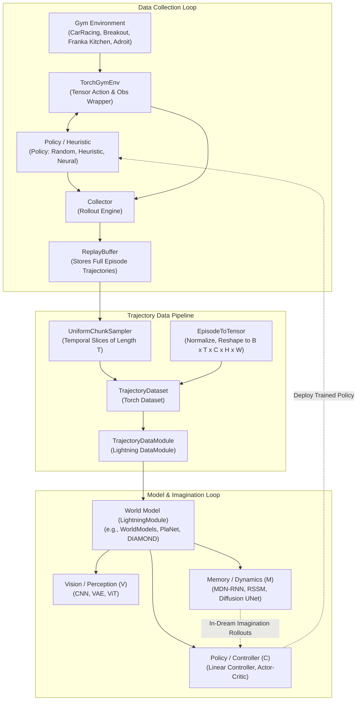

# Wiskers: Modular Framework for World Models & Policy Learning

**Wiskers** is a modular, plug-and-play research and engineering playground designed for building, training, and benchmarking **World Models** and **Policy Learning** architectures across simulated environments and robotics manipulation.

The core philosophy of Wiskers is **strict decoupling and composability**. Data collection, memory storage, trajectory sampling, perception backbones, latent dynamics, and control policies are isolated into modular interfaces. Any environment can be paired with any trajectory collector, any replay buffer, and any world model architecture—allowing researchers to swap environments, dynamics models, or policy learning algorithms with zero pipeline rewrites.

---

## 1. System Architecture & Component Interaction Flow

The Wiskers pipeline operates as a closed-loop system connecting simulation environments, trajectory buffers, neural world models, and imagination-based policies.



---

## 2. Low-Level Component Breakdown

### 2.1 Environments (`wiskers.envs`)
- **Role**: Wraps underlying simulators (Gymnasium, MuJoCo, Atari, Gymnasium-Robotics) into a unified PyTorch contract.
- **Key Abstraction — `TorchGymEnv`**:
  - Automatically manages device tensors, observation normalization, and action conversion.
  - Supports continuous vector actions (e.g. 3-DoF for CarRacing, 9-DoF for Franka Kitchen, 24-DoF for Adroit Hand) and discrete actions (e.g. Atari Breakout).
  - Provides a single step/reset API:
    $$\text{obs}_{t+1}, r_t, d_t, \text{info} = \text{env.step}(a_t)$$

### 2.2 Policies (`wiskers.common.policies`)
- **Role**: Implements action selection strategies during environment rollout or inference.
- **Key Abstraction — `Policy`**:
  - Exposes `policy(obs, step) -> torch.Tensor` with explicit `reset()` lifecycle.
  - Pluggable variants:
    - **Random**: Uniform exploration over action spaces.
    - **Heuristic**: Rule-based expert/exploration controllers (e.g., PID tracking for CarRacing, target reacher for Franka).
    - **Neural**: Trainable actors or latent controllers optimized via RL or Evolutionary Strategies.

### 2.3 Collector (`wiskers.data.collector`)
- **Role**: Orchestrates rollouts by stepping a `Policy` inside an `Env` and assembling complete `Episode` records.
- **Contract**:
  - Runs for a configured number of episodes with constraints (`min_steps`, `max_steps`).
  - Produces immutable `Episode` objects containing synchronous sequence tensors:
    - `obs`: $(T + 1, H, W, C)$
    - `actions`: $(T, A)$
    - `rewards`: $(T,)$
    - `dones`: $(T,)$
  - Seeds the buffer offline before training, or runs asynchronously online to continuously collect new transitions.

### 2.4 Buffer (`wiskers.data.buffer`)
- **Role**: Trajectory storage container decoupled from neural network batching.
- **Key Abstraction — `ReplayBuffer`**:
  - Stores complete episode rollouts up to `capacity_episodes`.
  - Fast random indexing by episode ID, tracking global step counts and total episodes.
  - Designed strictly as a data store without coupling to training losses or algorithms.

### 2.5 Sampler (`wiskers.data.sampler`)
- **Role**: Temporal slicing strategy that cuts fixed-length trajectory chunks from variable-length stored episodes.
- **Key Abstraction — `UniformChunkSampler`**:
  - Samples contiguous sequences of length $T$ across all available episodes in the buffer:
    $$(\text{obs}_{t:t+T+1}, a_{t:t+T}, r_{t:t+T}, d_{t:t+T})$$
  - Enforces bounds checking and episode length validation.

### 2.6 Transforms (`wiskers.data.transforms`)
- **Role**: Functional data preparation from raw environment arrays to training tensor batches.
- **Key Abstraction — `EpisodeToTensor`**:
  - Rescales uint8 visual frames to normalized float32 ranges (e.g. $[0, 1]$ or $[-1, 1]$).
  - Handles shape permutes between channels-last $(H, W, C)$ and channels-first $(C, H, W)$.
  - Applies spatial resizing and channel conversions (Grayscale $\leftrightarrow$ RGB).

### 2.7 DataModule (`wiskers.data.datamodule`)
- **Role**: PyTorch Lightning integration binding the ReplayBuffer, Sampler, Transform, and PyTorch DataLoaders.
- **Key Abstraction — `TrajectoryDataModule`**:
  - Self-contained: automatically triggers `collector.collect()` to seed the buffer during `setup()` if empty.
  - Produces batched PyTorch tensors for Lightning training:
    ```python
    batch = {
        "obs": torch.Tensor,      # [B, T + 1, C, H, W]
        "actions": torch.Tensor,  # [B, T, action_dim]
        "rewards": torch.Tensor,  # [B, T]
        "dones": torch.Tensor,    # [B, T]
    }
    ```

### 2.8 World Models & Modules (`wiskers.modules`, `wiskers.world_models`)
- **Role**: PyTorch Lightning modules implementing the perception, memory dynamics, and imagination loop.
- **Sub-components**:
  - **Vision / Perception ($V$)**: Encoders mapping high-dimensional observations $o_t$ to compact latents $z_t$, and decoders reconstructing $\hat{o}_t$ from $z_t$.
  - **Memory / Dynamics ($M$)**: Autoregressive or generative models predicting future latents $z_{t+1}$ conditioned on previous history $(z_{\le t}, a_{\le t})$.
  - **Controller / Actor ($C$)**: Policy heads mapping latent representations and recurrent states $(z_t, h_t)$ to actions $a_t$.

---

## 3. Configuration Composition (`configs/`)

To guarantee maximum modularity, configurations are decomposed into three independent directories:

```
configs/
├── datasets/     # Defines Env, Policy, Collector, Buffer, Sampler, Transform
├── modules/      # Defines Neural Architectures (Vision, Dynamics, Controller)
└── training/     # Composes Datasets + Modules, adding Trainer & Logger options
```

A training config simply references a dataset and a module using Hydra `defaults:` and overrides only task-specific parameters:

```yaml
# configs/training/carracing_world_models.yaml
defaults:
  - dataset: carracing
  - module: world_models
  - _self_

tensor_board_logger:
  save_dir: "./experiments"
  name: "world_models"

trainer:
  max_epochs: 100
  log_every_n_steps: 10
```

---

## 4. Paper Implementations in Wiskers

### 4.1 Classic World Models (Ha & Schmidhuber, 2018)

*"Recurrent World Models Facilitate Policy Evolution"* — [arXiv:1803.10122](https://arxiv.org/abs/1803.10122)

```
Raw Frame (x_t) ──> [ Vision V (VAE) ] ──> Latent Code (z_t)
                                                  │
Action (a_t) ─────────┬───────────────────────────┤
                      ▼                           ▼
            [ Memory M (MDN-RNN) ] ◄── Recurrent State (h_t)
                      │                           │
                      ▼                           ▼
            Distribution p(z_{t+1})     [ Controller C ] ──> Action (a_{t+1})
```

#### Architecture Mapping:
1. **Vision Model ($V$)**:
   - `CNNEncoder`: Convolutions downsampling $(3, 64, 64) \to z_t \in \mathbb{R}^{32}$.
   - `CNNDecoder`: Transposed convolutions reconstructing $\hat{x}_t$ from $z_t$.
2. **Memory Model ($M$)**:
   - `MDNRNN`: PyTorch LSTM cell followed by a Mixture Density Network (`MDNHead`) predicting a mixture of $K=5$ Gaussians over $z_{t+1}$, plus a Bernoulli done head:
     $$p(z_{t+1} \mid z_t, a_t, h_t) = \sum_{k=1}^K \pi_k \mathcal{N}(\mu_k, \sigma_k^2)$$
3. **Controller ($C$)**:
   - `Controller`: Compact single-layer linear mapping:
     $$a_t = W_c [z_t, h_t] + b_c$$

#### Execution in Wiskers:
- **Data Ingestion**: `TrajectoryDataModule` supplies chunks of 50 steps from `CarRacing` or `FrankaKitchen`.
- **Training Step (`wiskers/world_models.py`)**:
  1. The frozen encoder computes $z_t = \text{encoder}(o_t)$ for the sequence.
  2. The MDN-RNN consumes $(z_{0:T-1}, a_{0:T-1})$ to output mixture parameters $(\pi, \mu, \sigma)$ and termination probabilities $\hat{d}$.
  3. The model optimizes the MDN negative log-likelihood (`MDNRNN.mdn_loss`) and binary cross-entropy (`done_loss`).
- **Zero-Code Environment Swapping**:
  - Swap from CarRacing ($A=3$) to Franka Kitchen ($A=9$) simply by switching the dataset default and specifying `module.mdn_rnn.action_size: 9`.

---

### 4.2 DIAMOND (Alonso et al., 2024)

*"Diffusion for World Modeling: Visual Details Matter in Atari"* — [arXiv:2405.12399](https://arxiv.org/abs/2405.12399)

DIAMOND replaces discrete tokens and Gaussian latent vectors with a continuous-time diffusion model directly modeling visual pixel dynamics.

```
Past Context (o_{t-L:t}, a_{t-L:t})
              │
              ▼
   [ Adaptive Denoiser (UNet) ] ◄── Noise Level σ_t
              │
              ▼
     Generated Next Frame (o_{t+1}) ──> [ Reward & End Model ] ──> (r_t, d_t)
              │
              ▼
   [ Actor-Critic in Imagination ] ──> Action a_{t+1} (Horizon H=15)
```

#### Architecture Mapping:
1. **Diffusion World Model**:
   - **Preconditioning**: EDM framework (Karras et al., 2022) with continuous noise sampling $\ln(\sigma) \sim \mathcal{N}(P_{\text{mean}}, P_{\text{std}}^2)$.
   - **Backbone**: Conditional 2D U-Net with `AdaGroupNorm` and residual blocks (`CondResBlock2D`) modulated by noise scale and action embeddings.
   - **Sampler**: Deterministic Heun/Euler solver generating sharp next frames in as few as 3 sampling steps.
2. **Reward & Termination Predictor**:
   - Lightweight recurrent convnet predicting scalar/categorical rewards $\hat{r}_t$ and episode termination $\hat{d}_t$.
3. **Actor-Critic Policy**:
   - Actor $\pi_\phi(a_t \mid o_{\le t})$ and Critic $V_\phi(o_{\le t})$ trained entirely inside imagined rollouts without interacting with the simulator.

#### Integration in Wiskers:
- Reuses the exact same `ReplayBuffer` and `TrajectoryDataModule`.
- The top-level `DIAMOND(L.LightningModule)` unrolls imagined trajectories for horizon $H=15$, computing generalized advantage estimation (GAE) and $\lambda$-returns directly in imagination.

---

## 5. Development Principles

1. **Decoupled Data Containers**: Storage (`ReplayBuffer`) never contains training logic. Samplers (`TrajectorySampler`) determine batching rules.
2. **Unified Action Contracts**: Policies, controllers, and environments share standard PyTorch tensor shapes regardless of continuous or discrete spaces.
3. **Reproducible Experimentation**: Every run is fully configured via Hydra/OmegaConf YAMLs with seed reproducibility across simulators, collectors, and PyTorch backends.
4. **Fast Dev Sanity Checks**: Use `--fast_dev_run` for 1-batch non-logging verification, and `--quick_run` for lightweight integration tests before launching long-running experiments.
