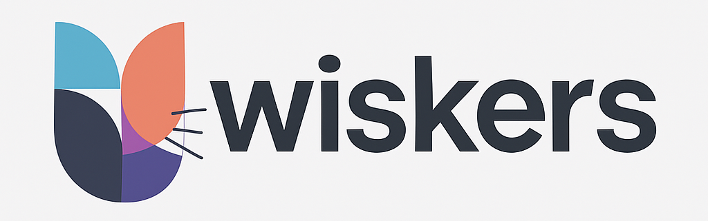

# Wiskers: World Models & Policy Learning Playground




Wiskers is a modular PyTorch framework to build, train, and play world models and policies in simulation. It decouples Torch-first environments, trajectory collection, replay buffers, neural blocks, and Lightning training systems so you can iterate cleanly from imagination to simulated execution.

> For the full architecture, component breakdown, and paper walkthroughs, see [PROJECT.md](PROJECT.md).

## Table of Contents

- [Architecture](#architecture)
- [Environments](#environments)
- [Installation](#installation)
- [Training](#training)
- [Play](#play)
- [Inspection](#inspection)
- [Development](#development)
- [License](#license)

## Architecture

Wiskers composes environments, collectors, buffers, and neural models via Hydra config groups:

- **`configs/dataset/`**: Environment adapters, rollout policies, collectors, replay buffers, and chunk samplers.
- **`configs/module/`**: Lightning systems assembling pure-PyTorch blocks (`wiskers/nn/`).
- **`configs/training/`**: Experiment entrypoints composing a dataset and module group in `defaults:`:

```yaml
defaults:
  - dataset: car_racing
  - module: world_models
  - _self_
```

```text
wiskers/
├── envs/        # Torch-first Gymnasium & MuJoCo adapters + env policies
├── policy/      # Discrete, continuous, and random Controller policies
├── planner/     # Model-based receding-horizon MPC planners
├── data/        # Episode TensorDicts, buffers, samplers, Collector, DataModule
├── nn/          # Pure PyTorch blocks, losses, quantizers, WM components
├── systems/     # PyTorch Lightning training systems (WorldModels, PlaNet)
└── pipeline/    # Hydra config loader, CLI scripts (train, play, inspect_dataset), backends
```

## Environments

All environments emit multi-modal flat `TensorDict` observations (`"render"` as `uint8`, plus optional `"ram"` / `"state:*"` tensors):

| Environment | Backend | Action Space | Observation Fields | Config |
| --- | --- | --- | --- | --- |
| Breakout | ALE | `Discrete(4)` | `render`, `ram` | `dataset/breakout` |
| CarRacing | Box2D | `Continuous(3)` | `render`, `state:car`, `state:wheels` | `dataset/car_racing` |
| InvertedPendulum | MuJoCo | `Continuous(1)` | `render`, `state:qpos`, `state:qvel` | `dataset/inverted_pendulum` |
| FrankaKitchen | MuJoCo | `Continuous(9)` | `render`, `state:robot_qpos`, `state:robot_qvel`, `state:obj_qpos`, `state:obj_qvel` | `dataset/franka_kitchen` |
| AdroitHand | MuJoCo | `Continuous(28)` | `render`, `state:hand`, `state:obj` | `dataset/adroit_hand` |
| ShadowHand | MuJoCo | `Continuous(20)` | `render`, `state:hand_qpos`, `state:hand_qvel`, `state:obj_qvel`, `state:achieved_goal`, `state:desired_goal` | `dataset/shadow_hand` |

## Installation

Wiskers uses [uv](https://github.com/astral-sh/uv) for dependency management. Sync the environment once, then run all commands with `uv run` (no manual virtualenv activation needed):

```bash
uv sync --all-extras
```

## Training

Launch training with any configuration under `configs/training/`:

```bash
# Run with a config group name
uv run python wiskers/pipeline/train.py --config <training_config>

# Example: train World Models on CarRacing (resolves ./configs/training/car_racing_world_models.yaml)
uv run python wiskers/pipeline/train.py --config training/car_racing_world_models

# Or pass a direct YAML path (including saved snapshots for reproducibility)
uv run python wiskers/pipeline/train.py --config experiments/world_models/version_0/config.yaml

# Optional custom config root directory
uv run python wiskers/pipeline/train.py --config-path ./configs --config training/car_racing_world_models
```

> **Experiment Reproducibility**: Every full training run saves a resolved configuration snapshot to `experiments/<name>/<version>/config.yaml`, so any run can be reproduced or played directly via `--config`.

### CLI Overrides

Override config groups or nested hyperparameters directly from the command line:

```bash
# Swap dataset group (e.g., train World Models on Breakout)
uv run python wiskers/pipeline/train.py --config training/car_racing_world_models dataset=breakout

# Override trainer or module parameters
uv run python wiskers/pipeline/train.py --config training/car_racing_world_models trainer.max_epochs=20 module.vae.latent_dim=64
```

## Play

Play a trained checkpoint or exported artifact (`.ckpt`, `.safetensors`, `.onnx`) in the environment:

```bash
# Generic command
uv run python wiskers/pipeline/play.py --config <training_config> --checkpoint <artifact_path>

# Example
uv run python wiskers/pipeline/play.py --config training/car_racing_world_models --checkpoint experiments/world_models/version_0/checkpoints/best.ckpt
```

## Inspection

### Dataset CLI

Verify trajectory collection, replay buffer shapes, and DataModule batches for any environment in [Environments](#environments):

```bash
# Generic command
uv run python wiskers/pipeline/inspect_dataset.py --config dataset/<env>

# Example
uv run python wiskers/pipeline/inspect_dataset.py --config dataset/franka_kitchen
```

### WebUI

Launch the interactive Streamlit WebUI to inspect collected episodes, DataModule chunks, and single-action sweeps:

```bash
./webui/run.sh
```

<details>
<summary>Screenshot</summary>
<p align="center"></p>
</details>

## Development

### Tests

```bash
uv run pytest
```

### Dev Runs

Use `--fast_dev_run` for a single-batch sanity check or `--quick_run` for a short end-to-end training run with checkpointing and logging:

```bash
uv run python wiskers/pipeline/train.py --config training/car_racing_world_models --fast_dev_run
uv run python wiskers/pipeline/train.py --config training/car_racing_world_models --quick_run
```

### Code Quality

Format, lint, and type-check with Ruff and Pyrefly (configured in `pyproject.toml` and `pyrefly.toml`):

```bash
uv run ruff format .
uv run ruff check --fix .
uv run pyrefly check
```

### TensorBoard

```bash
uv run tensorboard --logdir=experiments/ --port=6006
```

### Docker

The [Dockerfile](Dockerfile) builds on NVIDIA CUDA 12.4 (`MUJOCO_GL=egl`) with `uv` and locked dependencies pre-installed:

```bash
# Build Docker image
./build_docker.sh

# Start container
docker run --rm -it wiskers:latest
```

## License

Wiskers is licensed under the MIT License — see [LICENSE](LICENSE) for details.
