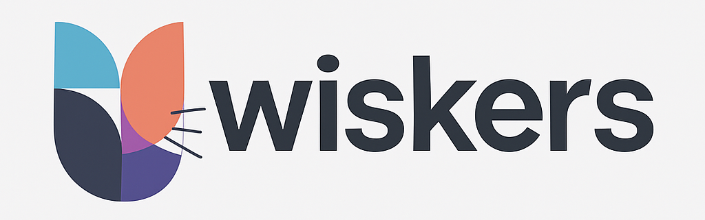

# Wiskers: World Models & Policy Learning Playground



Wiskers is a modular framework to build, train, and evaluate world models and policies in simulation. Starting with core world model and policy training, Wiskers is designed to progressively support diverse architectures for reinforcement learning and generative dynamics—including latent world models, diffusion policies, Vision-Language-Action models (VLAs), behavior cloning, and actor-critic RL—providing an experimental playground to train policies and benchmark agent intelligence from imagination to simulated execution.

> 📘 For the full architecture, component breakdown, and system blueprint, see [PROJECT.md](PROJECT.md)

## Architecture & Modular Configs

Wiskers decouples environments, trajectory collection, buffers, and neural architectures into plug-and-play components configured via Hydra:

- **`configs/datasets/`**: Simulation environments, policies, collectors, replay buffers, and chunk samplers.
- **`configs/modules/`**: Neural world models, perception encoders/decoders, dynamics, and controllers.
- **`configs/training/`**: Composes a dataset and module via `defaults:`, specifying training loops and environment-specific overrides.

For an in-depth component diagram and paper walkthroughs (World Models, DIAMOND), read [PROJECT.md](PROJECT.md).

## Installation

Wiskers uses [uv](https://github.com/astral-sh/uv) for fast and reproducible environment.

1. Install `uv` if not already installed:
```bash
brew install uv
```

2. Create the virtual environment and install all dependencies:
```bash
uv sync --all-extras
```

3. Activate the virtual environment:
```bash
source .venv/bin/activate
```

## Tests

Run unit tests:

```bash
pytest tests
```

### Development Runs

`--fast_dev_run`

Use this for the fastest sanity check that everything compiles and runs without executing the full training pipeline:

```bash
python wiskers/cli/train.py --config <config_yaml> --fast_dev_run
```

`--quick_run`

Use this to simulate a short training run and catch bugs across the full pipeline (checkpointing, logging, etc.):

```bash
python wiskers/cli/train.py --config <config_yaml> --quick_run
```

## Training

Launch training with a chosen experiment configuration file (`<config_yaml>`):

```bash
python wiskers/cli/train.py --config <config_yaml>

# World Models on CarRacing-v3
python wiskers/cli/train.py --config configs/training/carracing_world_models.yaml

# World Models on Franka Kitchen
python wiskers/cli/train.py --config configs/training/franka_kitchen_world_models.yaml
```

## Prediction & Evaluation

Run evaluation or inference with a configuration:

```bash
python wiskers/cli/predict.py --config <config_yaml>
```

## Inspect Datasets

Inspect and verify trajectory dataloaders and rollout replay buffers:

```bash
# Atari Breakout trajectory dataloader
python wiskers/cli/inspect_dataset.py --config configs/datasets/breakout.yaml

# CarRacing-v3 trajectory dataloader
python wiskers/cli/inspect_dataset.py --config configs/datasets/carracing.yaml

# Franka Kitchen robotics manipulator trajectory dataloader
python wiskers/cli/inspect_dataset.py --config configs/datasets/franka_kitchen.yaml

# Adroit Hand dexterous manipulation trajectory dataloader
python wiskers/cli/inspect_dataset.py --config configs/datasets/adroit_hand.yaml
```

## Streamlit WebUI

Streamlit provides an interactive WebUI to explore rollout trajectories, transitions, and models:

```bash
./streamlit.sh
```

<details>
<summary>Screenshot</summary>
<p align="center"></p>
</details>

## Tensorboard

Track ML experiments and training metrics:

```bash
tensorboard --logdir=experiments/ --port=6006
```

## Docker

### Build Docker container

```bash
./build_docker.sh
```

### Start Docker container

```bash
docker run --rm -it wiskers:1.0
```

## Code Formatter & Type Checking

```bash
# Check and format code with ruff (configured in pyproject.toml)
ruff check --fix

# Check static types with Pyrefly (configured in pyrefly.toml)
pyrefly check
```

## License

Wiskers is licensed under the MIT License — see the [LICENSE](https://github.com/electricshadok/wiskers/blob/main/LICENSE) file for details.
